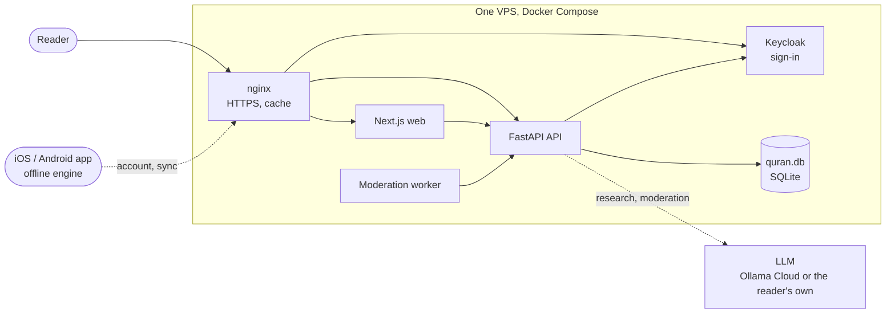
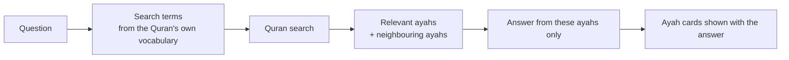
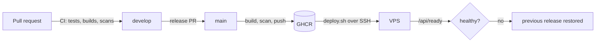

# Q-Basair — «بصائر القرآن»

Read and research the Quran with evidence: an authentic Madani mushaf, exact search over Arabic words, roots and phrases, recitation, and a study assistant that answers **only from the ayahs it finds**.

**Use it:** [basairquran.com](https://basairquran.com) · [guide](https://basairquran.com/guide) · [FAQ](https://basairquran.com/faq)

**Status:** public beta ([releases](https://github.com/Ghost0n/basair-quran/releases))

## What it does

| | |
|---|---|
| **Search** | Exact words (Arabic prefixes and Quranic spelling handled), roots, phrases within an ayah, "did you mean" suggestions. Deterministic: the same query always gives the same ayahs, counts and highlights. |
| **Read** | The Madani mushaf (Ḥafṣ), page by page as printed or ayah by ayah, with word analysis (root, lemma, iʿrāb) and translations of the meanings from QuranEnc and Tanzil. |
| **Listen** | Recitations from Quran.com, mp3quran.net and everyayah.com, with the recited ayah highlighted and ranges (page, surah, juz, hizb) on repeat. |
| **Study** | A research assistant grounded in the Quran alone: it searches, keeps the relevant ayahs, and answers from them, with no tafsir, hadith or outside source. It says so when the ayahs don't answer. |
| **Organise** | Highlight ayahs by theme, arrange them on boards, write versioned research documents, export or share them. |
| **Share** | A community feed of published research, with moderation by an AI agent and people. |
| **Anywhere** | 24 interface languages (RTL and LTR), and an offline-first iOS and Android app. |

## How it fits together



- **`api`** (FastAPI) owns the Quran: normalization, search, the reader, accounts and the research agent.
- **`web`** (Next.js) is the interface. The same code, built with `NEXT_PUBLIC_APP_MODE=1`, is the mobile app.
- **`packages/offline-engine`** is the Quran routes ported to TypeScript, so the app answers on the device. A parity suite keeps it identical to the server.
- **Keycloak** handles sign-in (email, Google), with the realm defined as code. The mobile app signs in on its page in the system's sign-in sheet (PKCE, tokens in the Keychain / Keystore).

### How the research assistant answers



The model only proposes search terms and writes the answer. The ayahs come from the same deterministic search as the search page.

## Repository

| Path | What |
|---|---|
| `src/app` | FastAPI app: routes, models, search and research services |
| `apps/web` | Next.js web, also the mobile app's bundle |
| `apps/mobile` | Capacitor iOS and Android projects |
| `apps/keycloak-theme`, `apps/keycloak-email-code` | the sign-in pages' theme and email-code extension |
| `packages/offline-engine`, `packages/shared`, `packages/api-client` | on-device engine, shared types, typed API client |
| `scripts` | database, translations, recitations, offline packs, Keycloak realm |
| `data` | Quran sources (generated databases are not committed) |
| `deploy`, `docker-compose.yml` | production stack and server scripts |
| `tests` | backend tests |

## Run it locally

Requirements: Python 3.11, Node 22 with pnpm.

```powershell
pip install -r requirements.txt
python scripts/build_db.py               # builds data/quran.db
python scripts/start_api.py              # API on http://127.0.0.1:8001
```

In a second terminal:

```powershell
powershell -ExecutionPolicy Bypass -File scripts/start_web_dev.ps1   # web on http://127.0.0.1:3000
```

The research assistant uses Ollama Cloud by default: add a key in the app's settings, or set `OLLAMA_API_KEY`. Accounts are off locally unless `QBASAIR_AUTH_ENABLED=1`. Sign-in with a local Keycloak is described in [docs/keycloak.md](docs/keycloak.md).

## Tests

```powershell
$env:PYTHONPATH='.'; pytest -q                                     # backend
powershell -ExecutionPolicy Bypass -File scripts/build_web.ps1    # web build
```

Every pull request also runs the web and app builds, the offline engine's parity, the Docker images, and Trivy scans.

## Deployment

A merge into `main` builds and scans the images, then deploys them to the VPS with a health check and automatic rollback. Tags in the merge commit (`[rebuild-db]`, `[rebuild-translations]`…) start data jobs. Full guide: [docs/deployment.md](docs/deployment.md).



## Learn more

[API](docs/api-contract.md) · [mushaf reader](docs/authentic-mushaf-reader.md) · [translations](docs/quran-translations.md) · [recitations](docs/recitation-audio.md) · [offline app](docs/offline-app.md) · [sign-in](docs/keycloak.md) · [moderation](docs/community-moderation-design.md) · [AI connections](docs/ai-connections.md) · [languages](docs/i18n.md) · [design system](docs/design-system.md)

## Contributing

Bug reports (above all a wrong search result, root or count), translation fixes and code are welcome: see [CONTRIBUTING.md](CONTRIBUTING.md). First-time contributors sign the [CLA](CLA.md) once, by commenting on their pull request. Please read the [Code of Conduct](CODE_OF_CONDUCT.md) and [Security](SECURITY.md).

## License

Code: [AGPL-3.0](LICENSE). If you run a modified version as a service, offer its source to its users.

The Quran text and its data keep their publishers' terms: the King Fahd Complex (text and page fonts), the Quranic Arabic Corpus (morphology), QuranEnc and Tanzil (translations), Quran.com, mp3quran.net and everyayah.com (recitations). Details in [NOTICE.md](NOTICE.md).
